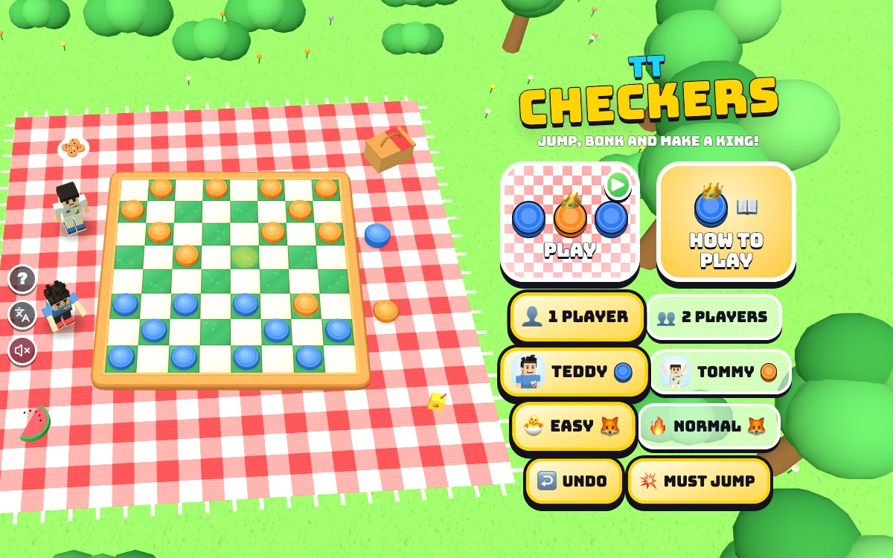

# TT Checkers

[](https://adong.github.io/checkers-tt/)

Press **?** any time (or tap the round **?** button on the left edge) to see the keys. The game waits while you look.
Tap the language button under it (the A文 icon) to switch between English and 中文; the dashboard and every game remember the choice.

Checkers on a picnic blanket in the park: Teddy's blue pieces against Tommy's orange ones (or against 🦊 Foxy), with big BONKs, multi-jumps and little gold crowns. 1 or 2 players.

**中文：** 野餐垫上的西洋跳棋：Teddy 的蓝色棋子对 Tommy 的橙色棋子（或者对 🦊 Foxy），跳吃、连跳、升王戴金冠！单人或双人。

A checkers game (American checkers, 8×8) starring Teddy and Tommy, built with Claude Code from plain JavaScript and Three.js on the shared Claude Games kit. The board is a chunky wooden board with green and cream squares, on a red-and-white picnic blanket with a basket, a watermelon slice, a juice box and a plate of cookies. There are no image, model or audio files: the boys are the kit's blocky characters, Foxy is the 🦊 emoji on a podium, the board and every texture are painted on a canvas, and every sound is synthesised.

The name is a working title. It lives in one constant, `CK_TITLE` in `js/title.js`, and the page title, the logo and the ? panel read it from there.

## Play

- **Double-click `index.html`.** It works offline because Three.js and the kit are copied into `kit/`. Without internet the title font falls back to Arial Black.
- **Send one file:** `dist/checkers-tt.html` is the whole game in one page. AirDrop or email it, then open it in a browser.
- Rebuild that file after any edit: `python3 kit/tools/bundle.py . --name checkers-tt`

## Rules

American checkers (English draughts):

- **The board:** 8×8, played on the dark (green) squares only, 12 pieces each. **Teddy's colour is blue, Tommy's is orange.** Your pieces start at your end of the board, and the camera looks from your end.
- **Moving:** one step diagonally forward, onto an empty dark square.
- **Jumping:** if an enemy piece is diagonally next to you and the square behind it is empty, jump over it to take it: a big **BONK!**, and the piece hops off the board onto the pile beside it. Men jump forward only.
- **Multi-jumps:** if the jumping piece can jump again from where it lands, it keeps going, all in one move (a double or triple jump). You can pick any way to go; it doesn't have to be the longest.
- **Captures are compulsory:** if you can jump, you must (the pieces that must jump glow orange). **MUST JUMP** on the menu switches that off, a house rule for Tommy: then jumping is a choice, but a jump still keeps going to the end.
- **Kings:** a man that reaches the far row is crowned **KING ME!**: a little gold crown pops onto it. Kings move and jump both ways, forward and backward. **Crowning ends the move**, even if the new king could jump again.
- **Winning:** you win when the other side has no pieces left, or can't move on their turn (boxed in). The winner does his signature move beside the board (Teddy's boxing combo or his 🏀 jump shot, in turn; Tommy's Y with peace fingers ✌️; Foxy spins), the loser shrugs, and when a kid wins there's confetti. Then **PLAY AGAIN**.
- **Draw:** 40 moves each (80 in a row) with no jump and no new king. A red "DRAW IN 20 MOVES" countdown shows for the last 20.
- **The score keeps running** from game to game for the same players and level until the page is closed. **Who goes first swaps every game**; you go first in the first game (Teddy, in 2 players).

### Who you play

- **1 player:** you pick Teddy (blue) or Tommy (orange), and **🦊 Foxy** plays the other colour.
  - **🐣 EASY** (the default, for Tommy, 5): Foxy looks one move ahead (her move and your answer) with a lot of wobble in her sums, and about half the time just plays any legal move. She jumps when she must, but she makes gentle mistakes, like leaving a piece where you can jump it.
  - **🔥 NORMAL** (for Teddy, 8): Foxy thinks with an alpha-beta search at least 6 moves deep (often 7 – 10), carrying on through any jumps at the end so she never stops in the middle of an exchange. Her score for a board counts pieces (a king is worth 1.5 men), men close to crowning, men guarding her back row, the middle of the board, kings away from the edges, and in the endgame the side ahead likes to trade and to chase with its kings. Between moves that score the same she picks at random, so games differ.
  - **She never freezes the page:** her thinking runs a few milliseconds each frame (one branch at a time), while she rocks her head and a 🤔 floats above her.
- **2 players:** Teddy and Tommy take turns on one device.

### Helpers

- **Tap a piece** and its moves glow: a green dot on each square it can finish on (gold if it would be crowned there), small white rings on the squares a multi-jump hops through, dotted arcs over each jump, and a red ring and 💥 on every piece it would take. Tap the last square to play the whole jump, or tap a square it hops through to pick that way when there are two.
- **The pieces that must jump glow orange**, and the turn line says "YOUR TURN: JUMP!".
- **Tap a square you can't go to** and a short line says why: "ONLY KINGS GO BACKWARD!", "YOU MUST JUMP!", "ONE STEP AT A TIME!".
- **The last move** stays lit in soft yellow, every square of its path.
- **↩️ Undo** (top left, or **U**): against Foxy it takes back your move and her answer, so it's your turn again; in 2 players it takes back one move. It works as often as you like, even after the game ends (the result comes off the score). **UNDO** on the menu switches the button off.
- **📖 How to play** (top left, or **H**): the rules with pictures: moving, jumping, a double jump, crowning a king, kings going backward, must jump, winning and the draw.

## Controls

| | Keys | Touch |
|---|---|---|
| move round the board · pick up a piece or put it down | ← ↑ → ↓ · Enter or Space | tap a piece, then tap a glowing square |
| put the piece back | Esc | tap it again |
| undo your last move | U or Backspace | ↩️ (top left) |
| call your brother (2 players: high five) | T | his face, bottom right (🙌 in 2 players) |
| new game | R | 🔄 on the pause screen |
| how to play | H | 📖 (top left) |
| pause · sound | P or Esc · M | ⏸️ · 🔊 |
| menu: play · Teddy or Tommy · 1 or 2 players | Enter · ← → · ↑ ↓ | the tiles and buttons |
| menu: level · undo on or off · must jump on or off | L · U · J | the buttons under the tiles |

- **The arrow keys** move a yellow frame the way they point on the screen, from dark square to dark square; up and down keep to the column you were heading for.
- **The star that bobs over a head** shows whose turn it is.
- **Square sizes** (one square on screen, measured at the far edge, where they are smallest; the near ones are bigger): iPad upright 768×1024 57 px, iPad on its side 1024×768 42 px deep and 64 px wide, phone upright 390×844 about 41 px wide and 36 px deep, phone on its side 740×360 about 37 px wide and 28 px deep. On a tall screen the round ? and language buttons move to the bottom left corner during a game and the players stand in front of and behind the board, so the board can use the whole width; on a phone on its side the score moves to a column on the right so the board can use the whole height, and the camera looks down more steeply on both.

## Call your brother (companion mode)

**1 player:** Foxy is the CPU, so your brother is free to help. Call him with **T** or by tapping his face (bottom right), **any time and as often as you like** (`Kit.roster.buddyFor`: Tommy for Teddy, Teddy for Tommy).

- **He pops in** beside you in a puff of stars, at his roster `buddyScale` (a smaller Tommy, a slightly smaller Teddy), with his name tag.
- **He says hi** with his signature move (Tommy's Y with peace fingers, Teddy's boxing combo) and **tosses you a treat** (🍦 💧 🧃 🍪 🍉 🍌) that arcs into your hand: "🍪 COOKIE FROM TOMMY!"
- **He shows you the best move:** he turns and points, the piece and the square glow gold, gold dots trace the whole path (every hop of a multi-jump), a 👇 bounces over the square, and a toast says what it is: "TOMMY SAYS: DOUBLE JUMP!" (or "JUMP!", "TRIPLE JUMP!", "MAKE A KING!", "THIS ONE WINS!", "TRY THIS ONE!"). When one of your pieces can be jumped, a ❗ bounces over it and he says "THAT PIECE CAN BE JUMPED!", pointing at a move that saves it (if saving it would cost too much, he shows the best move without the warning). His move is Foxy's NORMAL thinking, a little deeper, without the coin toss. If it's Foxy's turn when he arrives, he waits for yours.
- **Once you've moved**, he does his goodbye move and pops out. Call him again while he's there and he says hi again, brings another treat and points again.
- **His button wiggles** when one of your pieces can be jumped (with a soft "uh-oh") or a double jump is waiting: a good time to call him.

**2 players:** both brothers are already at the board, so **T** (or 🙌) is a **high five**: they run together beside the board (round its corners on a tall screen), slap hands (💥) and run back. It doesn't change the game.

## Make it yours

- `js/title.js`: the game's name.
- `js/rules.js`: `EASY` (how often Foxy plays any move, how wobbly her sums are) and `NORMAL` (how deep she thinks: `minDepth`, `maxDepth`, and the `nodes` budget that decides whether she goes deeper). `MAN` / `KING` and `evaluate()` are her sums; `DRAW_PLIES` is the draw rule.
- `js/game.js`, top: `SCALE` (the boys' size), `THINK_MS` (how long Foxy may think per frame).
- `js/stage.js`: the park, the blanket, the board's colours (`SQ_L`, `SQ_D`), the pieces (`COL`, `PR`, `PH`) and the crown.

## How it works, and how it's tested

- `js/rules.js` has no Three.js and no page in it: the board, the moves, the rules, Foxy and your brother's tip. The same file runs the game and the headless checks.
  - Squares are numbered 0 – 31, four dark squares a row, with tables of each square's diagonal neighbours. A move is the whole sequence: `{ from, to, path, caps, crown }`. Jumps are found by a depth-first search that marks each jumped piece so it can't be jumped twice, and the jumping piece leaves its square (a king can jump round in a ring and land where it started).
  - Foxy's thinking is a job: `think(state, level)` returns `{ step(ms) }`, which searches one root move at a time until `ms` runs out; `cpuMove()` runs one to the end (for the checks).
- `js/game.js` runs the games and turns each move into hops, BONKs, the crown, sounds and the boys' reactions.
- Console hooks (`window.game`):

```js
game.start({ players: 1, who: 'tommy', level: 'easy', undo: true, forced: true })   // straight into a game
game.tapRC(5, 2)          // tap the square at row 5, column 2 (row 0 is the top); game.tap(i) takes 0..31
game.setup([[1, 6, 1], [3, 5, 2], [3, 3, 4]], 0)   // a board: [piece, row, col] (1 blue man, 2 blue king, 3 orange man, 4 orange king), whose turn
game.undo()               // the undo button
game.call()               // call your brother (2 players: high five)
game.step(2)              // advance 2 s and draw (when the browser tab's animation is throttled)
game.hold(true)           // freeze the live loop, so only game.step() moves time
game.auto(true, 'easy')   // a test bot plays the kid's side too
game.perft(6)             // move sequences from the start, 6 moves deep (36768)
game.check()              // the headless checks below (game.rates() for the win rates)
game.info()               // state, board, turn, score, the brother, the hint, square size on screen
```

The same checks run from a terminal with Node:

```bash
node tools/check.js 12
```

```bash
node tools/check.js 4 --sabotage nomulti
```

```bash
node tools/check.js rates 40
```

- **perft:** the number of move sequences from the start position must match the known values for American checkers: depths 1 – 6 = 7, 49, 302, 1469, 7361, 36768 (with blue or orange first). Depth 7 gives 179,740, also the known value.
- **The rules on little boards** (45 checks): men step forward only and kings all four ways; jumps are compulsory (and optional with MUST JUMP off); the jumped piece comes off; men can't jump backward, kings can; double and triple jumps are one move and you can't stop half way; two ways to go are both legal; a king's ring jump; crowning ends the move (the new king doesn't jump on), while a king already crowned jumps through the far row; no pieces or no moves loses; the draw comes on the 80th quiet move, and a capture or a crowning starts the count again; Foxy jumps when she must and NORMAL takes a free double jump and avoids a jump-back trap; your brother's tip shows a double and a triple jump with the whole path, warns about a piece that can be jumped and saves it, crowns a king, and takes a winning jump.
- **CPU games:** NORMAL against EASY (both colours), EASY against EASY, NORMAL against NORMAL, and the test bots, every fourth game with MUST JUMP off. Every move is checked against the legal list, every game must end, and NORMAL must beat EASY in at least 80% of games.
- **It can fail:** `--sabotage` breaks one thing first, and each makes the check fail: `noforce` (jumps never compulsory: perft 379 at depth 3, and 5 more rule checks), `nomulti` (a jump stops after one piece: 10 rule checks), `nocrownstop` (a man crowned in a jump jumps on as a king: 2 rule checks), `backward` (men may step backward: perft 340 at depth 3, and 5 more), `nodraw` (no draw rule: games never end, and 2 rule checks), `blind` (NORMAL plays at random: it beat EASY in only 2 of 8 games).
- **At the last check** (`node tools/check.js 12`, 44 s): 45 of 45 rule checks; 84 games, 6,572 moves, none illegal; every game ended (4 draws, the longest 249 moves); NORMAL beat EASY in 24 of 24 games.
- **Win rates with bots** (`node tools/check.js rates 200`: 200 games each, the bot as blue and as orange in turn). Not a pass or fail check; it's how EASY was tuned. The bots: "little" (like a 5-year-old: jumps when he must, otherwise steps anywhere, and half the time checks the piece he moves can't be jumped straight away), "kid" (like an 8-year-old: looks one move ahead), and a random bot. RATES_PLACEHOLDER
- **The browser:** whole games through the real renderer (`game.auto`) to PLAY AGAIN, calling the brother every few seconds; a triple jump to a crown; the brother's double-jump tip with its path; the 2-player high five on a wide and a tall screen; undo in 1 and 2 players; the keyboard (cursor, pick up, move, undo, pause, rules, sound, new game); tapping a hop square to choose between two double jumps. 中文: every screen and toast (home in 1 and 2 players, the ? panel, the rules, a game with the brother, must-jump and why-not lines, pause, undo, a win and a draw, 2 players and the high five), and `Kit.lang.untranslated()` stayed `[]` (planted strings, on the page and on the canvas, were caught). English: no Chinese anywhere except the kit's language button tooltip. Layouts measured and looked at: 1200×750, 1024×768 and 768×1024 (iPad), phone upright 390×844, phone on its side 740×360; the kit's ? and language buttons never cover the board. No console errors.
- **Offline:** `index.html` and `dist/checkers-tt.html` boot from `file://` in headless Chrome (`tools/shoot.js`), with the tab icon and the apple-touch-icon in place, and play a move and Foxy's answer with real animation frames, with no page errors.
- **Never freezing:** in headless Chrome (software rendering), with NORMAL thinking, the longest gap between frames was 67 ms (median 33 ms, most of it drawing).

## Files

```
index.html               page, HUD, menus, panels, the rules with pictures (CSS inline)
js/title.js              the game's name (one constant)
js/rules.js              the rules, perft, Foxy (alpha-beta, sliced so the page never freezes), your brother's tip (no Three.js)
js/check.js              the headless checks, the sabotages, the test bots and the win-rate report (game.check, game.rates, tools/check.js)
js/stage.js              the park, the blanket, the board, the pieces and crowns, hops, BONKs and the piles, the glows, the camera fit, picking
js/actor.js              a boy beside the board (from TT Jungle Chess) and Foxy on her podium (from TT Flying Chess)
js/buddy.js              your brother's visit and tip, and the 2-player high five
js/fx.js                 emoji flyers, word bursts, confetti
js/sfx.js                game sounds on top of Kit.sound
js/game.js               the games, turns, input, undo, Foxy's timing, the score, screens, main loop, window.game hooks
js/keys.js               the keys the ? panel shows (Kit.help)
js/zh.js                 中文 for every word the player sees (Kit.lang); names and the game's name stay English
tools/check.js           runs the headless checks under Node
tools/shoot.js           screenshots with headless Chrome (tools/shots.json makes docs/screenshot.jpg)
kit/                     copy of ~/claude-games/kit (python3 ../kit/tools/sync.py .), never edited here
dist/checkers-tt.html    the single-page build
```

## Not verified

- **Sound:** the synth code runs without errors, but nobody listened to it (every test ran muted).
- **Real touch devices:** taps were tested with the game's own hooks and the layouts in the browser's phone and tablet sizes, but no real phone or iPad was used. On a phone the far squares are the smallest (about 37 × 28 px on its side, 41 × 36 px upright).
- **Real kids:** the levels are tuned with test bots (see the win rates above). How EASY feels for Tommy, and whether NORMAL is too hard for Teddy (the 8-year-old-like bot never beat it; his brother's tips are Foxy-strength), needs Tommy and Teddy. `EASY` and `NORMAL` in `js/rules.js` are the knobs.
- **Speed on an old iPad:** Foxy thinks a few milliseconds per frame, but one branch of her search can take longer on a slow device; measured only on a Mac.
- **Double-click from Finder:** `index.html` and `dist/checkers-tt.html` were opened from `file://` in headless Chrome, not by double-clicking in Finder.
- **The iPad home-screen icon:** the apple-touch-icon is drawn by script like the siblings'; nobody added it to a real iPad.
